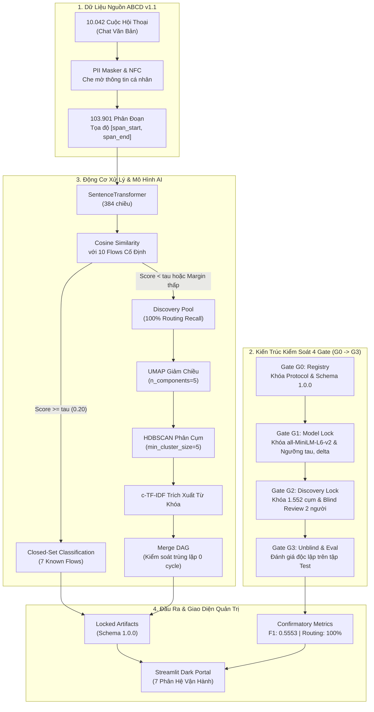

# BÁO CÁO TỔNG KẾT ĐỀ TÀI NGHIÊN CỨU & THỰC TẬP TỐT NGHIỆP

# NGHIÊN CỨU ỨNG DỤNG MÔ HÌNH BERTOPIC TRONG PHÂN LOẠI CHỦ ĐỀ CỐ ĐỊNH VÀ TỰ ĐỘNG KHÁM PHÁ NHU CẦU MỚI TỪ HỘI THOẠI CHĂM SÓC KHÁCH HÀNG

---

- **Loại tài liệu**: Báo cáo Kỹ thuật & Luận văn Thực tập Tốt nghiệp (Technical & Thesis Report)
- **Phiên bản**: `1.0.0`
- **Mã thực nghiệm (Experiment ID)**: `phase1` / `consolidated_v1`
- **Bộ chuẩn dữ liệu**: ABCD v1.1 (*Action-Based Conversations Dataset*)
- **Mô hình cốt lõi**: `sentence-transformers/all-MiniLM-L6-v2` kết hợp `BERTopic`, `UMAP`, `HDBSCAN`, `c-TF-IDF`
- **Trạng thái nghiệm thu**: **PASS / HUMAN_VERIFIED / VALID**

---

## 📑 MỤC LỤC TỔNG QUAN HỆ THỐNG BÁO CÁO

Báo cáo được chia thành 7 chương chuyên sâu, mỗi chương là một tài liệu Markdown độc lập có liên kết chéo:

### 📖 [Chương I: Tổng Quan & Bối Cảnh Đề Tài](file:///c:/Hoc_tap/HK1_Nam4_ThucTap/BERTopic/bao_cao/CHUONG_I_TONG_QUAN_VA_BOI_CANH_DE_TAI.md)
1. Bối cảnh chăm sóc khách hàng đa kênh (Omnichannel Customer Service)
2. Thách thức giữa Phân loại Danh mục Cố định (Closed-Set) và Nhu cầu Mới (Novel Discovery)
3. Mục tiêu và phạm vi nghiên cứu của đề tài PoC
4. Phân biệt các khái niệm cốt lõi: Topic vs. Intent vs. Action
5. Những câu hỏi nghiệp vụ doanh nghiệp cần giải quyết

### 📖 [Chương II: Cơ Sở Lý Thuyết & Công Nghệ Lựa Chọn](file:///c:/Hoc_tap/HK1_Nam4_ThucTap/BERTopic/bao_cao/CHUONG_II_CO_SO_LY_THUYET_VA_CONG_NGHE.md)
1. Tổng quan kiến trúc mô hình BERTopic
2. Tầng nhúng văn bản (Sentence Transformers & all-MiniLM-L6-v2)
3. Giảm chiều phi tuyến tính với UMAP (Uniform Manifold Approximation and Projection)
4. Phân cụm mật độ dựa trên phân cấp HDBSCAN và cơ chế lọc nhiễu (-1)
5. Biểu diễn từ khóa chủ đề theo lớp c-TF-IDF (Class-based TF-IDF)
6. Bài toán Nhận diện Tập Mở (Open-Set Recognition) & Ngưỡng Cosine $\tau, \delta$
7. Các độ đo đánh giá: Macro-F1, Unknown F1, Routing Recall, ARI, Rubric Thẩm định mù

### 📖 [Chương III: Kiến Trúc Hệ Thống & Quy Trình Kiểm Soát 4 Gate](file:///c:/Hoc_tap/HK1_Nam4_ThucTap/BERTopic/bao_cao/CHUONG_III_KIEN_TRUC_VA_QUY_TRINH_4_GATE.md)
1. Triết lý kiến trúc 4 Gate (G0 $\to$ G1 $\to$ G2 $\to$ G3) chống rò rỉ dữ liệu (No Data Leakage)
2. Gate G0: Khóa Experiment Registry, phân chia tập K vs H, và Schema 1.0.0
3. Gate G1: Khóa cấu hình mô hình, tìm kiếm ngưỡng trên tập Dev K
4. Gate G2: Khóa kết quả phân cụm tập mở, quy trình thẩm định mù (Blinded Review) 2 chuyên gia
5. Gate G3: Mở nhãn đánh giá độc lập (Unblind) và đóng băng kết quả đo lường
6. Kiểm soát trùng lặp và phân mảnh chủ đề bằng Đồ thị Sáp nhập (Merge DAG)

### 📖 [Chương IV: Quy Trình Tiền Xử Lý Dữ Liệu & Trích Xuất Bằng Chứng](file:///c:/Hoc_tap/HK1_Nam4_ThucTap/BERTopic/bao_cao/CHUONG_IV_TIEN_XU_LY_VA_CHUAN_BI_DU_LIEU.md)
1. Khám phá tập dữ liệu chuẩn ABCD v1.1 (10.042 cuộc hội thoại)
2. Chuẩn hóa văn bản Unicode NFC và nguyên tắc che mờ thông tin định danh (PII Masking)
3. Phân rã câu thoại thành 103.901 phân đoạn bằng chứng (Evidence Units)
4. Phân loại trạng thái nội dung: `analyzable`, `non_need`, `insufficient_evidence`
5. Định vị tọa độ bằng chứng chính xác `[span_start:span_end]` không trôi lệch

### 📖 [Chương V: Kết Quả Thực Nghiệm & Phân Tích Đánh Giá](file:///c:/Hoc_tap/HK1_Nam4_ThucTap/BERTopic/bao_cao/CHUONG_V_KET_QUA_THUC_NGHIEM_VA_DANH_GIA.md)
1. Bảng tổng hợp chỉ số xác nhận (Confirmatory Acceptance Metrics)
2. Đánh giá phân loại Closed-Set trên 10 flows ($Macro\text{-}F1 = 0.5553$)
3. Đánh giá nhận diện luồng chưa biết Unknown Detection ($F1 = 0.3618, Recall = 100\%$)
4. Đánh giá khả năng thu hồi họ chủ đề mới ($Routing\text{ }Recall = 100\%$, $2/2\text{ }Flows$ thu hồi)
5. Kết quả thẩm định mù ngữ nghĩa (498 cụm `accepted_novel`, 7 cụm `monitor`)
6. Chẩn đoán độ ổn định phân cụm ARI giữa các Random Seeds và tác động của độ dài cuộc gọi

### 📖 [Chương VI: Xây Dựng Ứng Dụng Web Dashboard Phục Vụ Quản Trị & Vận Hành](file:///c:/Hoc_tap/HK1_Nam4_ThucTap/BERTopic/bao_cao/CHUONG_VI_XAY_DUNG_UNG_DUNG_WEB_DASHBOARD.md)
1. Định hướng kiến trúc Web App: Từ Báo cáo nghiên cứu đến Cổng Quản trị Vận hành (Staff Portal)
2. Triết lý thiết kế giao diện Dark Mode AI SaaS chống chói
3. Chi tiết 7 phân hệ giao diện Streamlit:
   - *Phân hệ 1*: Overview & Giám sát tiến trình 4 Gate
   - *Phân hệ 2*: Fixed Topic Analytics & Bảng 4 đơn vị đếm
   - *Phân hệ 3*: New Topic Discovery & Trực quan hóa Merge DAG
   - *Phân hệ 4*: Conversation Explorer & Tô sáng tọa độ bằng chứng
   - *Phân hệ 5*: Model Evaluation & Trình đọc toàn văn báo cáo Markdown
   - *Phân hệ 6*: Live Data Analyzer (Phân tích tức thì & Quét file CSV hàng loạt)
   - *Phân hệ 7*: Topic Approval Management (Phê duyệt chủ đề mới vào Taxonomy)
4. Kịch bản vận hành thực tế và các lưu ý khi demo cho hội đồng / doanh nghiệp

### 📖 [Chương VII: Kết Luận, Giới Hạn Hệ Thống & Hướng Phát Triển Tương Lai](file:///c:/Hoc_tap/HK1_Nam4_ThucTap/BERTopic/bao_cao/CHUONG_VII_KET_LUAN_GIOI_HAN_VA_HUONG_PHAT_TRIEN.md)
1. Tổng kết các đóng góp chính của đề tài PoC
2. Tính minh bạch về các giới hạn kỹ thuật (Ngôn ngữ tiếng Anh, nhãn proxy, metadata khuyết `\N`)
3. Lộ trình phát triển giai đoạn tiếp theo (Phase 2):
   - Mở rộng xử lý đa ngôn ngữ và tiếng Việt (PhoBERT, ViBERT)
   - Tích hợp giọng nói với Speech-to-Text (Whisper / Google ASR)
   - Xây dựng luồng MLOps hoàn chỉnh với cơ chế Human-in-the-loop

---

### 🖼️ [Danh Mục Hình Ảnh & Biểu Đồ Thực Nghiệm (bao_cao/images/)](file:///c:/Hoc_tap/HK1_Nam4_ThucTap/BERTopic/bao_cao/images/)
Toàn bộ hình ảnh trong thư mục này là **ảnh thật 100%** được vẽ bằng Python Matplotlib (300 DPI) từ chính các file dữ liệu nghiệm thu thực tế (`metrics.json`, `ontology.json`, `candidates.jsonl`):
1. **[hinh_1_phan_bo_10_flow_intents.png](file:///c:/Hoc_tap/HK1_Nam4_ThucTap/BERTopic/bao_cao/images/hinh_1_phan_bo_10_flow_intents.png)**: Phân bố cấu trúc 10 Flow Families & Subflows trong tập dữ liệu ABCD v1.1.
2. **[hinh_2_ket_qua_kiem_dinh_chi_so_f1_recall.png](file:///c:/Hoc_tap/HK1_Nam4_ThucTap/BERTopic/bao_cao/images/hinh_2_ket_qua_kiem_dinh_chi_so_f1_recall.png)**: So sánh kết quả thực nghiệm với các tiêu chí nghiệm thu khắt khe (F1 0.5553, Recall 100%, 2/2 Flow Recovery).
3. **[hinh_3_hieu_nang_theo_do_dai_hoi_thoai.png](file:///c:/Hoc_tap/HK1_Nam4_ThucTap/BERTopic/bao_cao/images/hinh_3_hieu_nang_theo_do_dai_hoi_thoai.png)**: Hiệu năng phân loại theo 3 phân nhóm độ dài lượt thoại (Short 1-2, Medium 3-5, Long 6+).
4. **[hinh_4_phan_bo_kich_thuoc_498_cum_moi.png](file:///c:/Hoc_tap/HK1_Nam4_ThucTap/BERTopic/bao_cao/images/hinh_4_phan_bo_kich_thuoc_498_cum_moi.png)**: Phân bố mật độ quy mô hội thoại của 498 cụm chủ đề mới phát hiện được chấp thuận.
5. **[hinh_5_co_che_ranh_gioi_hai_nguong_tau_delta.png](file:///c:/Hoc_tap/HK1_Nam4_ThucTap/BERTopic/bao_cao/images/hinh_5_co_che_ranh_gioi_hai_nguong_tau_delta.png)**: Không gian quyết định hai chiều phân định giữa Closed-Set Routing và Unknown Discovery ($\tau = 0.20, \delta = 0.05$).

---

## 🗺️ SƠ ĐỒ KIẾN TRÚC TỔNG THỂ ĐỀ TÀI

---

## 📚 BẢNG THUẬT NGỮ VIẾT TẮT (GLOSSARY)

| Thuật ngữ | Tiếng Anh đầy đủ | Định nghĩa / Ý nghĩa trong đề tài |
|---|---|---|
| **PoC** | Proof of Concept | Thử nghiệm chứng minh tính khả thi của giải pháp AI. |
| **CSKH** | Customer Service | Nghiệp vụ chăm sóc và hỗ trợ khách hàng. |
| **ABCD** | Action-Based Conversations Dataset | Bộ ngữ liệu 10.042 cuộc hội thoại dịch vụ khách hàng chuẩn hóa của Google Research. |
| **BERTopic** | Bidirectional Encoder Representations Topic Modeling | Khung mô hình phân cụm và trích xuất chủ đề văn bản hiện đại kết hợp Transformer. |
| **c-TF-IDF** | Class-based Term Frequency - Inverse Document Frequency | Phương pháp đo lường tầm quan trọng của từ khóa theo từng lớp cụm chủ đề. |
| **UMAP** | Uniform Manifold Approximation and Projection | Thuật toán học cấu trúc đa tạp và giảm chiều dữ liệu phi tuyến tính. |
| **HDBSCAN** | Hierarchical Density-Based Spatial Clustering of Applications with Noise | Thuật toán phân cụm mật độ phân cấp có khả năng tự động xử lý điểm ngoại lai/nhiễu (-1). |
| **PII** | Personally Identifiable Information | Thông tin định danh cá nhân (tên, email, số điện thoại, số tài khoản). |
| **ARI** | Adjusted Rand Index | Thước đo đánh giá độ tương đồng và tính ổn định giữa hai kết quả phân cụm độc lập. |
| **DAG** | Directed Acyclic Graph | Đồ thị có hướng không chu trình, áp dụng để kiểm soát quan hệ kế thừa/sáp nhập chủ đề. |
| **Zero-Fit** | Zero-Fit on Render | Nguyên tắc ứng dụng Web chỉ đọc kết quả đã khóa trước, tuyệt đối không fit lại mô hình lúc hiển thị. |
