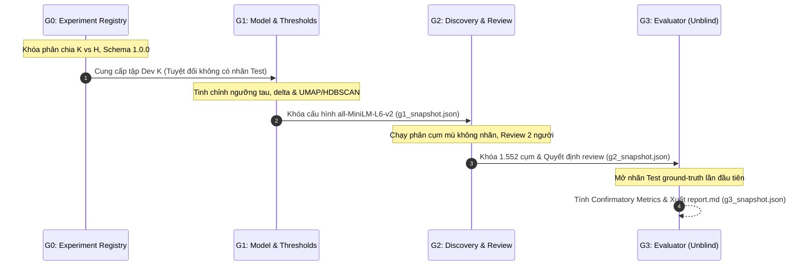
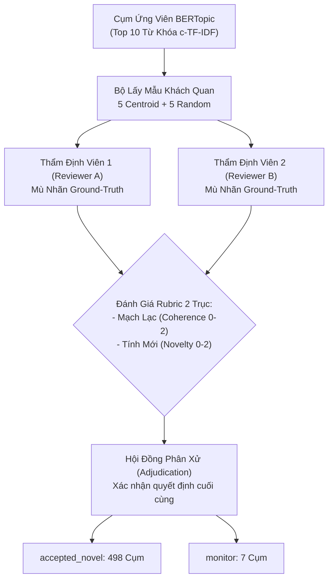

# CHƯƠNG III: KIẾN TRÚC HỆ THỐNG VÀ QUY TRÌNH KIỂM SOÁT 4 GATE

---

## 3.1. Thách Thức Về Tính Trung Thực Khoa Học & Rò Rỉ Dữ Liệu (Data Leakage)

Một trong những vấn đề nghiêm trọng nhất trong các nghiên cứu và ứng dụng Học máy (Machine Learning) là hiện tượng **Rò rỉ dữ liệu kiểm thử (Test Data Leakage)**:
- Người nghiên cứu vô tình (hoặc cố ý) sử dụng tập Test để lựa chọn mô hình, tinh chỉnh siêu tham số, hoặc chọn ngưỡng (Threshold Tuning).
- Các thuật toán phân cụm không giám sát (như BERTopic) nếu chạy trên toàn bộ tập dữ liệu đã biết nhãn sẽ dễ dàng "nhìn trộm" thông tin ngữ nghĩa của tập kiểm thử.
- Thẩm định viên đánh giá chất lượng cụm nếu biết trước nhãn kịch bản của cuộc hội thoại sẽ sinh ra thiên kiến xác nhận (Confirmation Bias), cho rằng cụm AI tìm ra luôn đúng.

Để đảm bảo tính khách quan khoa học ở mức cao nhất, đề tài thiết lập **Kiến trúc Kiểm soát 4 Gate (G0 $\to$ G1 $\to$ G2 $\to$ G3)** với cơ chế đóng băng tuần tự và đối soát mã băm SHA-256 bất biến.

---

## 3.2. Chi Tiết Các Gate Kiểm Soát Kiến Trúc

### 1. Gate G0: Experiment Registry & Access Policy Lock
- **Thời gian khóa**: Khởi tạo đầu tiên trước khi bất kỳ dòng code xử lý mô hình nào được chạy.
- **Nhiệm vụ cốt lõi**:
  - Khóa danh mục thực nghiệm: Phân chia rõ ràng giữa **Tập Đã Biết $K$** (7 Known flows) và **Tập Ẩn $H$** (1 flow kiểm thử phát triển `shipping_issue` và 2 flow kiểm thử cuối cùng `subscription_inquiry`, `troubleshoot_site`).
  - Thiết lập ranh giới phân quyền (*Access Control Policy*): Tách biệt vai trò *Trusted Custodian* (Người lưu trữ dữ liệu thô và nhãn ẩn) với vai trò *Model Developer* (Chỉ được tiếp xúc với văn bản câu thoại khách hàng đã che mờ PII).
  - Khóa chuẩn Schema 1.0.0 cho toàn bộ artifacts đầu ra.

### 2. Gate G1: Model Selection & Threshold Freezing
- **Điều kiện mở Gate**: Phải hoàn thành toàn bộ kiểm thử nền tảng (Foundation Tests) của Gate G0.
- **Nhiệm vụ cốt lõi**:
  - Thử nghiệm tìm kiếm mô hình nhúng và siêu tham số trên tập dữ liệu được phép (*Train K* và *Dev K*). Tuyệt đối **không chạm vào bất kỳ câu thoại nào của tập Test $H_{final}$**.
  - Chạy Grid Search 52 cấu hình ngưỡng Parent ($\tau \in [0.10, 0.60], \delta \in [0.00, 0.20]$) và chọn ra bộ tham số tối ưu: $\tau = 0.20, \delta = 0.05$.
  - Chạy Grid Search 16 cấu hình UMAP & HDBSCAN trên Dev Discovery Pool, lựa chọn: $n\_neighbors = 5, n\_components = 5, min\_cluster\_size = 5, min\_samples = 1$.
  - Đóng băng mã băm SHA-256 của các tệp lựa chọn mô hình vào `g1_snapshot.json`.

### 3. Gate G2: Open Test Discovery & Blinded Semantic Review
- **Điều kiện mở Gate**: Cấu hình mô hình và các ngưỡng đã bị khóa cứng tại Gate G1.
- **Nhiệm vụ cốt lõi**:
  - **Inference không nhãn (Unlabeled Inference)**: Chạy mô hình phân loại trên tập kiểm thử mở $S_{os}$. Toàn bộ các câu thoại bị từ chối được định tuyến vào Routed Discovery Pool.
  - **Phân cụm 3 Seeds & Ablation**: Chạy thuật toán BERTopic trên 3 Random Seeds độc lập (Seed 42 làm nhánh chính, Seed 13 và 73 làm nhánh kiểm chứng ổn định) và 1 nhánh All-unit Ablation. Thu được tổng cộng **1.552 cụm ứng viên**.
  - **Quy trình Thẩm định Mù (Blinded Review)**: Đánh giá chất lượng thực sự của cụm thông qua 2 chuyên gia độc lập (chi tiết tại mục 3.3).
  - Đóng băng mã băm toàn bộ cụm, mẫu kiểm tra và quyết định thẩm định vào `g2_snapshot.json`.

### 4. Gate G3: Independent Evaluation & Metric Unblinding
- **Điều kiện mở Gate**: Toàn bộ dự đoán mô hình, cụm phát hiện và biên bản review đã bị đóng băng hoàn toàn.
- **Nhiệm vụ cốt lõi**:
  - Evaluator độc lập được cấp quyền mở kho nhãn ground-truth `scenario.flow` của tập Test.
  - Tính toán các chỉ số xác nhận (Confirmatory Metrics): Macro-F1, Unknown F1, Routing Recall, Flow-family Recovery.
  - Sinh báo cáo nghiệm thu bất biến `artifacts/phase1/evaluation/report.md` và khóa toàn vẹn `g3_snapshot.json`.
  - Mọi sự can thiệp, sửa đổi siêu tham số hồi tố sau Gate G3 đều bị hệ thống phát hiện và gắn cờ `INVALID BENCHMARK`.

---

## 3.3. Quy Trình Thẩm Định Mù Ngữ Nghĩa (Blinded Semantic Review)

Để đánh giá một cụm từ mới do BERTopic tạo ra có thực sự là một chủ đề mới có nghĩa hay không, hệ thống áp dụng quy trình thẩm định mù chuẩn mực:

### 1. Chiến Lược Lấy Mẫu Đại Diện 5 + 5
Với mỗi cụm ứng viên, hệ thống tự động chọn ra đúng 10 mẫu câu thoại từ các cuộc hội thoại độc lập:
- **5 mẫu đại diện (Representative Samples)**: 5 câu thoại có khoảng cách vector gần tâm cụm (Centroid) nhất.
- **5 mẫu ngẫu nhiên (Random Samples)**: 5 câu thoại được lấy ngẫu nhiên có trọng số trong toàn bộ cụm nhằm kiểm tra độ thuần khiết ở vùng biên.

### 2. Tiêu Chí Rubric 2 Trục Độc Lập
Mỗi thẩm định viên chấm điểm mà không được biết nhãn thực tế của kịch bản ABCD:
- **Trục Coherence (Độ mạch lạc ngữ nghĩa)**:
  - Điểm 2: Rất mạch lạc, trên 80% số mẫu nói cùng một vấn đề thống nhất.
  - Điểm 1: Mạch lạc một phần, có lẫn tạp chất hoặc câu lạc đề.
  - Điểm 0: Rời rạc, tập hợp các từ khóa ngẫu nhiên không có ý nghĩa chung.
- **Trục Novelty (Tính mới đối với doanh nghiệp)**:
  - Điểm 2: Hoàn toàn mới, là nhu cầu phát sinh ngoài 7 luồng cố định đã biết.
  - Điểm 1: Trùng lặp một phần với các chủ đề có sẵn.
  - Điểm 0: Hoàn toàn là chủ đề cũ hoặc chỉ là các câu chào hỏi xã giao.

---

## 3.4. Kiểm Soát Trùng Lặp Chủ Đề Bằng Đồ Thị Sáp Nhập (Merge DAG)

Một hiện tượng phổ biến khi chạy BERTopic trên tập ngữ liệu lớn là **sự phân mảnh chủ đề** (*Topic Fragmentation*): Nhiều cụm nhỏ có ngữ nghĩa gần như giống hệt nhau cùng xuất hiện (ví dụ: cụm "hỏng khóa kéo áo" và cụm "áo bị lỗi khóa").

Hệ thống thiết lập cơ chế **Merge DAG** (*Directed Acyclic Graph*):
1. **Quy tắc sáp nhập tự động**: Hai cụm cùng Seed có tỷ lệ trùng lặp từ khóa $\ge 70\%$ và độ bao phủ hội thoại giao thoa $\ge 80\%$ sẽ được thiết lập quan hệ kế thừa có hướng: Cụm nhỏ hơn $\to$ Sáp nhập vào cụm lớn hơn.
2. **Kiểm tra tính phi chu trình (Acyclic Guarantee)**: Đồ thị sáp nhập được kiểm tra bằng thuật toán dò chu trình Tarjan/DFS. Tuyệt đối không cho phép tồn tại chu trình (ví dụ: Cụm A sáp nhập vào B, B sáp nhập vào C, C lại trỏ về A).
3. **Kết quả kiểm toán Gate G2**: Xác nhận **0 Cycles**, toàn bộ 498 cụm nghiệm thu đều đạt tính nguyên tử độc lập (Atomic Clusters) hoặc có quan hệ kế thừa hợp lệ.

---

*Chương tiếp theo: [Chương IV: Quy Trình Tiền Xử Lý Dữ Liệu & Trích Xuất Bằng Chứng](file:///c:/Hoc_tap/HK1_Nam4_ThucTap/BERTopic/bao_cao/CHUONG_IV_TIEN_XU_LY_VA_CHUAN_BI_DU_LIEU.md)*
