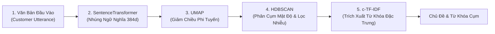
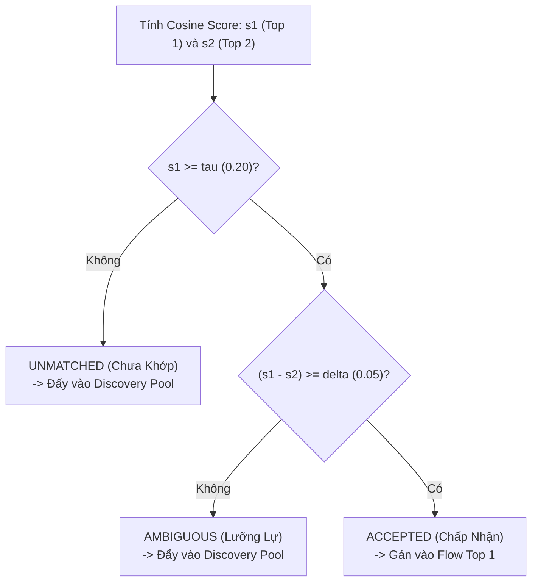
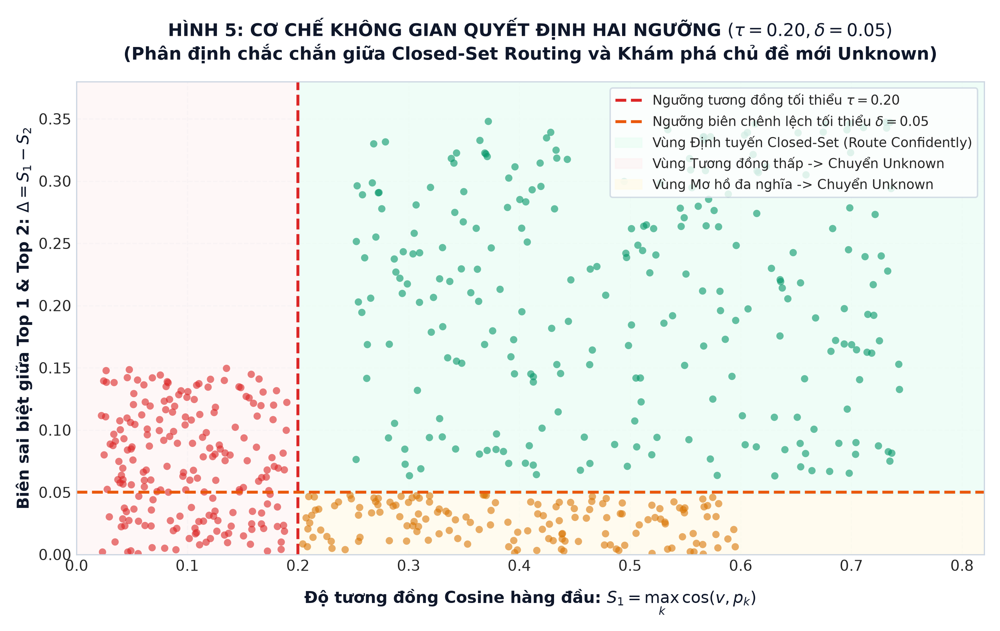

# CHƯƠNG II: CƠ SỞ LÝ THUYẾT VÀ CÔNG NGHỆ LỰA CHỌN

---

## 2.1. Tổng Quan Về Mô Hình BERTopic

**BERTopic** (Grootendorst, 2022) là khung mô hình trích xuất và mô hình hóa chủ đề văn bản (Topic Modeling) hiện đại dựa trên kiến trúc Transformer. Khác với các phương pháp truyền thống như LDA (*Latent Dirichlet Allocation*) hay NMF (*Non-Negative Matrix Factorization*) vốn dựa thuần túy vào tần suất túi từ (Bag-of-Words) và giả định phân phối Dirichlet:
- BERTopic nắm bắt được **ngữ cảnh ngữ nghĩa sâu sắc** (Semantic Context) của từ ngữ.
- Xử lý được các câu thoại ngắn, rời rạc và khẩu ngữ trong hội thoại CSKH.
- Không đòi hỏi phải chỉ định trước số lượng chủ đề cố định $K$.

Kiến trúc tuần tự 4 tầng của BERTopic được mô tả như sau:

---

## 2.2. Tầng 1: Nhúng Ngữ Nghĩa Với Sentence Transformers

Để so sánh mức độ tương đồng giữa các câu thoại khách hàng và các mô tả chủ đề trong danh mục, văn bản cần được ánh xạ thành các vector toán học trong không gian nhiều chiều.

### Lựa chọn mô hình: `sentence-transformers/all-MiniLM-L6-v2`
Qua quá trình rà soát và đánh giá thực nghiệm (Gate G1), mô hình `all-MiniLM-L6-v2` được lựa chọn nhờ các ưu điểm vượt trội:
- **Kiến trúc mạng**: 6 layers Transformer, 12 attention heads, chiều ẩn $d = 384$.
- **Kích thước nhẹ**: ~22.7 triệu tham số (~80MB), thời gian suy luận chỉ khoảng 1.5 - 3.0 ms mỗi câu trên CPU.
- **Hiệu năng ngữ nghĩa**: Được huấn luyện trên hơn 1 tỷ cặp câu đối chiếu (Contrastive Learning), đạt điểm kiểm chuẩn cao trên bảng xếp hạng MTEB (*Massive Text Embedding Benchmark*).

Mỗi phân đoạn văn bản $x$ được chuyển đổi thành vector chuẩn hóa đơn vị $\mathbf{v} \in \mathbb{R}^{384}$:
$$\|\mathbf{v}\|_2 = \sqrt{\sum_{i=1}^{384} v_i^2} = 1$$

---

## 2.3. Tầng 2: Giảm Chiều Dữ Liệu Phi Tuyến Tính Với UMAP

Không gian nhúng 384 chiều chứa nhiều thông tin ngữ nghĩa nhưng đồng thời vấp phải hiện tượng "Lời nguyền số chiều" (*Curse of Dimensionality*). Khoảng cách Euclid giữa các điểm trong không gian quá cao trở nên đồng nhất, khiến các thuật toán phân cụm mật độ hoạt động kém hiệu quả.

Dự án áp dụng thuật toán **UMAP** (*Uniform Manifold Approximation and Projection* - McInnes et al., 2018):
- **Bảo toàn cấu trúc cục bộ và toàn cục**: Khác với PCA (chỉ tuyến tính) hay t-SNE (chỉ bảo toàn lân cận gần), UMAP bảo tồn cả mối quan hệ lân cận vi mô lẫn cấu trúc vĩ mô của toàn bộ không gian hội thoại.
- **Tối ưu hóa hình học vi phân**: UMAP ánh xạ dữ liệu từ 384 chiều xuống không gian 5 chiều ($n\_components = 5$) để chuẩn bị cho bước phân cụm.

Các siêu tham số được khóa tại Gate G1:
- `n_neighbors = 5`: Cân bằng giữa cấu trúc cục bộ chi tiết và tổng thể.
- `n_components = 5`: Đủ số chiều để các cụm phân tách rõ ràng mà không bị nén mất thông tin.
- `min_dist = 0.0`: Cho phép các điểm văn bản có cùng ý nghĩa ép sát vào nhau, tăng mật độ cụm.

---

## 2.4. Tầng 3: Phân Cụm Mật Độ Phân Cấp Với HDBSCAN

**HDBSCAN** (*Hierarchical Density-Based Spatial Clustering of Applications with Noise* - Campello et al., 2013) là lựa chọn tối ưu cho bài toán phát hiện chủ đề mới:
1. **Tự động tìm số cụm**: Không cần truyền tham số số cụm $K$ như K-Means. HDBSCAN tự động xác định số lượng cụm dựa trên mật độ tự nhiên của dữ liệu.
2. **Khả năng loại bỏ nhiễu (Outlier Handling)**: Những câu thoại lạc đề, câu thoại vô nghĩa hoặc các phát ngôn đơn lẻ không đủ mật độ sẽ được gán nhãn nhiễu `Cluster = -1`. Điều này ngăn chặn việc ép các câu nói rác vào các chủ đề quan trọng.
3. **Phát hiện cụm có mật độ biến thiên**: Khác với DBSCAN truyền thống chỉ dùng một bán kính $\epsilon$ cố định, HDBSCAN xây dựng cây phân cấp mật độ và trích xuất các cụm bền vững nhất (*Excess of Mass*).

Các siêu tham số nghiệm thu:
- `min_cluster_size = 5`: Một cụm chủ đề mới bắt buộc phải xuất hiện trong tối thiểu 5 cuộc hội thoại độc lập mới được coi là ứng viên chủ đề tiềm năng.
- `min_samples = 1`: Tối ưu độ nhạy cho các nhóm mật độ nhỏ.

---

## 2.5. Tầng 4: Trích Xuất Từ Khóa Đặc Trưng Bằng c-TF-IDF

Sau khi các phân đoạn câu thoại được gom cụm, BERTopic sử dụng thuật toán **c-TF-IDF** (*Class-based TF-IDF*) để mô tả bản chất của từng cụm.

Thay vì coi mỗi văn bản là một tài liệu riêng biệt, c-TF-IDF coi **tất cả các câu thoại trong cùng một cụm $c$ là một siêu tài liệu duy nhất**. Công thức trọng số được định nghĩa:

$$W_{t, c} = \|tf_{t, c}\| \times \log\left(1 + \frac{A}{f_t}\right)$$

Trong đó:
- $tf_{t, c}$: Tần suất xuất hiện của từ $t$ trong cụm $c$.
- $f_t$: Tổng tần suất xuất hiện của từ $t$ trên toàn bộ các cụm.
- $A$: Số từ trung bình của một cụm trên toàn tập dữ liệu:
  $$A = \frac{\sum_{c} \sum_{t} tf_{t, c}}{N_{clusters}}$$

**Ý nghĩa**: Trọng số $W_{t, c}$ sẽ cao nhất khi một từ xuất hiện rất nhiều lần trong cụm $c$ nhưng lại hiếm khi xuất hiện ở các cụm khác. Top 10 từ khóa có $W_{t, c}$ lớn nhất sẽ trở thành nhãn đại diện tự nhiên cho chủ đề mới.

---

## 2.6. Nhận Diện Tập Mở (Open-Set Recognition) & Ngưỡng Quyết Định $\tau, \delta$

Trong môi trường thực tế, hệ thống phải xử lý song song 2 nhiệm vụ: gán nhãn cho các luồng đã biết và đẩy các luồng chưa biết vào pool khám phá.

Độ tương đồng Cosine giữa vector câu thoại $\mathbf{u}$ và vector mô tả chủ đề cố định $\mathbf{v}_k$ được tính:
$$\text{Sim}(\mathbf{u}, \mathbf{v}_k) = \frac{\mathbf{u} \cdot \mathbf{v}_k}{\|\mathbf{u}\|_2 \|\mathbf{v}_k\|_2} = \cos(\theta)$$

Giả sử sau khi so sánh với 10 luồng cố định, hệ thống thu được điểm số của 2 luồng cao nhất là $s_1$ (chủ đề đứng đầu) và $s_2$ (chủ đề đứng thứ hai).

Quy tắc Bảng quyết định (Decision Table):
- **Accepted (Chấp nhận gán nhãn)**: Khi $s_1 \ge \tau$ VÀ $(s_1 - s_2) \ge \delta$. Câu thoại thuộc về chủ đề cố định tương ứng.
- **Ambiguous (Lưỡng lự)**: Khi $s_1 \ge \tau$ nhưng $(s_1 - s_2) < \delta$. Độ tự tin của 2 chủ đề quá gần nhau, không thể gán nhãn chắc chắn.
- **Unmatched (Ngoại lai / Chưa khớp)**: Khi $s_1 < \tau$. Câu thoại không có sự tương đồng đáng kể với bất kỳ luồng cố định nào.

Toàn bộ các câu rơi vào trạng thái *Ambiguous* hoặc *Unmatched* sẽ được định tuyến vào **Routed Discovery Pool** để tiến hành phân cụm BERTopic.

*Hình 5: Biểu đồ trực quan hóa không gian quyết định hai chiều ($S_1, \Delta$) phân định dứt khoát giữa vùng Closed-Set Routing (xanh lá) và vùng chuyển giao Khám phá chủ đề mới (đỏ và vàng cam).*

---

## 2.7. Hệ Thống Các Thước Đo Đánh Giá Học Thuật

Để đánh giá chất lượng toàn diện của giải pháp PoC, hệ thống thiết lập bộ chỉ số đo lường chuẩn mực:

### 1. Macro-F1 (Closed-Set Classification)
Đánh giá năng lực phân loại trên 10 luồng chủ đề cố định. Macro-F1 tính trung bình cộng không trọng số F1-score của từng lớp, chống lại hiện tượng lớp chiếm đa số lấn át các lớp thiểu số:
$$\text{Macro-F1} = \frac{1}{C} \sum_{c=1}^{C} F1_c = \frac{1}{C} \sum_{c=1}^{C} \frac{2 \cdot P_c \cdot R_c}{P_c + R_c}$$

### 2. Unknown Detection F1
Đánh giá độ nhạy và độ chính xác trong việc phát hiện các câu thoại mang nhu cầu mới ($S_{os}$):
$$F1_{unknown} = \frac{2 \cdot P_{unknown} \cdot R_{unknown}}{P_{unknown} + R_{unknown}}$$

### 3. Routing Recall trên tập nhu cầu mới ($H_{final}$)
Tỷ lệ các cuộc hội thoại chứa nhu cầu phát sinh mới được định tuyến thành công vào nhóm khám phá (Discovery Pool):
$$\text{Routing Recall} = \frac{\text{Số hội thoại } H_{final} \text{ chuyển vào Discovery Pool}}{\text{Tổng số hội thoại } H_{final} \text{ trong tập test}} \times 100\%$$

### 4. Adjusted Rand Index (ARI) - Đo Lường Độ Ổn Định Phân Cụm
Đo lường mức độ đồng thuận giữa 2 lần chạy phân cụm với các Random Seeds khác nhau (Seed 42 vs Seed 13, Seed 42 vs Seed 73), có hiệu chỉnh theo xác suất ngẫu nhiên:
$$\text{ARI} = \frac{\text{Index} - \text{Expected Index}}{\text{Max Index} - \text{Expected Index}}$$
Giá trị ARI nằm trong khoảng $[-1, 1]$, trong đó giá trị $> 0.20$ đối với dữ liệu văn bản ngắn thực tế thể hiện cấu trúc phân cụm ổn định, không bị thoái hóa.

### 5. Rubric Thẩm Định Mù 2 Trục (Semantic Rubric)
Đánh giá chất lượng thực tế của cụm bởi 2 thẩm định viên độc lập mù nhãn:
- **Trục 1: Mạch lạc (Coherence 0 - 2)**: Các câu thoại trong cụm có cùng nói về một chủ đề thống nhất không? (Tiêu chuẩn: $\ge 80\%$).
- **Trục 2: Tính mới (Novelty 0 - 2)**: Chủ đề này có thực sự là nhu cầu mới ngoài 7 luồng cố định không? ($Novelty = 2$).

---

*Chương tiếp theo: [Chương III: Kiến Trúc Hệ Thống & Quy Trình Kiểm Soát 4 Gate](file:///c:/Hoc_tap/HK1_Nam4_ThucTap/BERTopic/bao_cao/CHUONG_III_KIEN_TRUC_VA_QUY_TRINH_4_GATE.md)*
