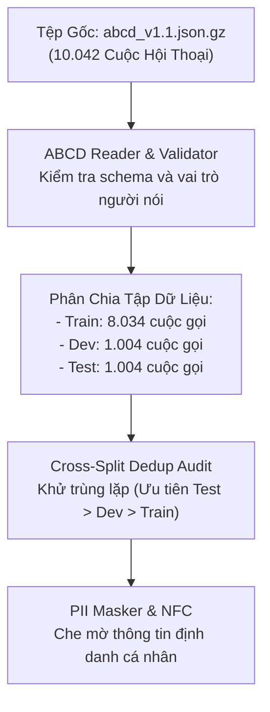
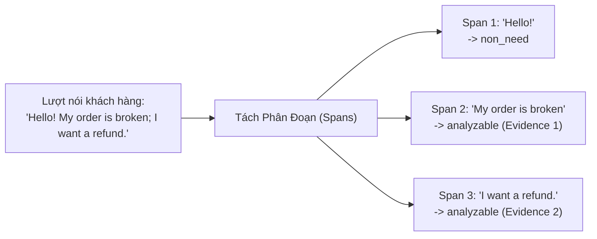

# CHƯƠNG IV: QUY TRÌNH TIỀN XỬ LÝ DỮ LIỆU VÀ TRÍCH XUẤT BẰNG CHỨNG

---

## 4.1. Khám Phá Bộ Ngữ Liệu Chuẩn ABCD v1.1

Đề tài sử dụng bộ ngữ liệu chuẩn **ABCD v1.1** (*Action-Based Conversations Dataset* - Chen et al., Google Research, 2021). Đây là một trong những tập dữ liệu hội thoại chăm sóc khách hàng quy mô và chi tiết nhất hiện nay:
- **Quy mô**: 10.042 cuộc hội thoại hoàn chỉnh với hơn 220.000 lượt thoại (turns).
- **Hình thức**: Hội thoại văn bản 2 chiều giữa Khách hàng (*Customer*) và Nhân viên hỗ trợ (*Agent*).
- **Cấu trúc nhãn kịch bản**: Mỗi cuộc hội thoại được định nghĩa bởi một kịch bản gồm `scenario.flow` (chủ đề lớn) và `scenario.subflow` (ý định chi tiết).
- **Tính toàn vẹn**: Tệp dữ liệu gốc `data/raw/abcd_v1.1.json.gz` được khóa mã băm SHA-256 bất biến trước và sau toàn bộ quá trình thực nghiệm.

---

## 4.2. Chuẩn Hóa Văn Bản & Bảo Vệ Thông Tin Định Danh (PII Masking)

Nhằm đảm bảo an toàn dữ liệu và tuân thủ các quy chuẩn bảo mật thông tin khách hàng, toàn bộ các câu thoại đều trải qua quy trình tiền xử lý nghiêm ngặt:

### 1. Chuẩn Hóa Unicode NFC
Văn bản tiếng Anh trong môi trường đa kênh thường gặp hiện tượng ký tự đồng dạng hoặc ký tự dấu gõ theo dạng tổ hợp (NFD). Hệ thống chuẩn hóa 100% văn bản sang dạng **NFC** (*Normalization Form C*), chuẩn hóa khoảng trắng ngang và giữ nguyên cấu trúc xuống dòng để không làm lệch tọa độ ký tự.

### 2. Che Mờ Thông Tin Cá Nhân (PII Masking)
Sử dụng từ điển thực thể mở (`ontology.values`) trích xuất từ dữ liệu công khai của ABCD để che mờ các trường nhạy cảm:
- Tên khách hàng $\to$ `[NAME]`
- Địa chỉ email $\to$ `[EMAIL]`
- Số điện thoại $\to$ `[PHONE]`
- Mã định danh tài khoản, số thẻ tín dụng $\to$ `[ID]`
- Địa chỉ giao hàng $\to$ `[ADDRESS]`

> [!NOTE]
> **Cam kết khoa học**: Cơ chế che mờ được xây dựng bằng rule-based lexicon mở, không sử dụng nhãn flow/subflow của kịch bản nhằm ngăn ngừa rò rỉ thông tin. Đề tài minh bạch ghi nhận đây là bước che mờ có thể bỏ sót các tên riêng mới lạ, không tự tuyên bố là ẩn danh tuyệt đối.

---

## 4.3. Phân Rã Phân Đoạn & Trích Xuất Bằng Chứng (Evidence Units)

Trong một cuộc trò chuyện, khách hàng có thể nói nhiều câu với các mục đích khác nhau. Nếu coi cả cuộc hội thoại là một khối văn bản duy nhất để vector hóa, thông tin sẽ bị pha loãng nghiêm trọng.

Quy trình phân rã câu thoại tuân theo các nguyên tắc:
1. **Chỉ trích xuất từ lượt nói khách hàng**: Lượt nói của nhân viên (*Agent turns*) và các hành vi hệ thống (*API actions*) tuyệt đối không được đưa vào vector hóa nhu cầu. Lời thoại trước đó của agent chỉ được lưu trữ dưới dạng `context_text` phục vụ việc truy vết ngữ cảnh.
2. **Tách phân đoạn theo dấu câu & chấm phẩy**: Phân tách các câu dựa trên dấu `.`, `!`, `?`, `;` và ký tự xuống dòng `\n`. Hệ thống có cơ chế kiểm tra *whitelist* để không bị tách nhầm tại các số thập phân (ví dụ: `$49.99`) hoặc các từ viết tắt phổ biến (`Dr.`, `Mr.`, `Inc.`, `e.g.`).
3. **Cửa sổ trượt (Sliding Window)**: Với các câu thoại quá dài, hệ thống áp dụng cửa sổ trượt tối đa 200 text tokens với độ gối đầu (*overlap*) 20 tokens để đảm bảo không bị ngắt quãng giữa chừng một ý nghĩa.

---

## 4.4. Quy Tắc Phân Loại Trạng Thái Nội Dung (Content Status)

Toàn bộ các phân đoạn sau khi tách được phân loại thành 3 trạng thái nội dung trước khi đưa vào mô hình học máy:

| Trạng thái | Định nghĩa & Tiêu chuẩn | Ví dụ thực tế | Số lượng phân đoạn |
|---|---|---|---|
| **`analyzable`** | Phân đoạn nêu nhu cầu nghiệp vụ thực sự, có độ dài và ý nghĩa đầy đủ để vector hóa. | *"I received my jacket yesterday but the zipper is broken."* | **80.112** (77.1%) |
| **`non_need`** | Câu thoại xã giao thông thường, chào hỏi, cảm ơn hoặc xác nhận ngắn, không chứa yêu cầu nghiệp vụ. | *"Hi", "Hello good morning", "Thank you very much", "Yes", "Bye"* | **18.648** (17.9%) |
| **`insufficient_evidence`** | Câu thoại quá ngắn ($< 3$ từ), câu nói lấp lửng hoặc chỉ chứa toàn bộ các token đã bị che mờ PII. | *"[ID]", "uhm...", "well"* | **5.141** (5.0%) |
| **TỔNG CỘNG** | **Toàn bộ phân đoạn trích xuất từ 10.042 cuộc hội thoại** | | **103.901** (100.0%) |

---

## 4.5. Định Vị Tọa Độ Bằng Chứng Chính Xác (Provenance Offsets)

Để hỗ trợ chuyên viên CSKH kiểm tra và thẩm định, hệ thống lưu trữ chính xác tọa độ vị trí của phân đoạn trong câu thoại gốc thông qua cặp số nguyên `[span_start:span_end]`:
- `span_start`: Chỉ số ký tự bắt đầu (tính từ 0) theo mã hóa Unicode NFC.
- `span_end`: Chỉ số ký tự kết thúc (không bao gồm).
- **Tính toán không trôi lệch (No Offset Drift)**: Tọa độ được tính trực tiếp trên chuỗi `masked_customer_text`. Khi giao diện Web cần tô màu (highlight), hệ thống cắt chuỗi chính xác theo lát cắt `text[span_start:span_end]`, tuyệt đối không dùng phương pháp tìm kiếm chuỗi con (regex search) vốn dễ gây highlight nhầm vào các từ trùng lặp ở vị trí khác.

Tất cả 103.901 phân đoạn cùng tọa độ và trạng thái được lưu trữ cố định tại tệp:
👉 `artifacts/phase1/preparation_v1/segments.jsonl`

---

*Chương tiếp theo: [Chương V: Kết Quả Thực Nghiệm & Phân Tích Đánh Giá](file:///c:/Hoc_tap/HK1_Nam4_ThucTap/BERTopic/bao_cao/CHUONG_V_KET_QUA_THUC_NGHIEM_VA_DANH_GIA.md)*
