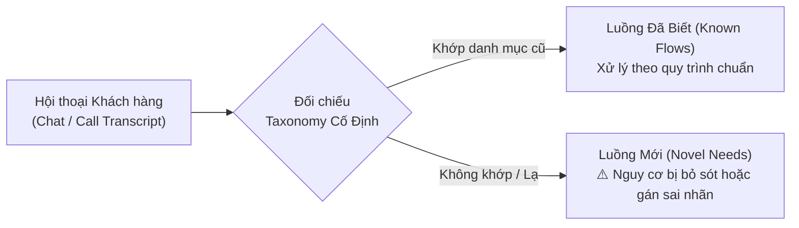
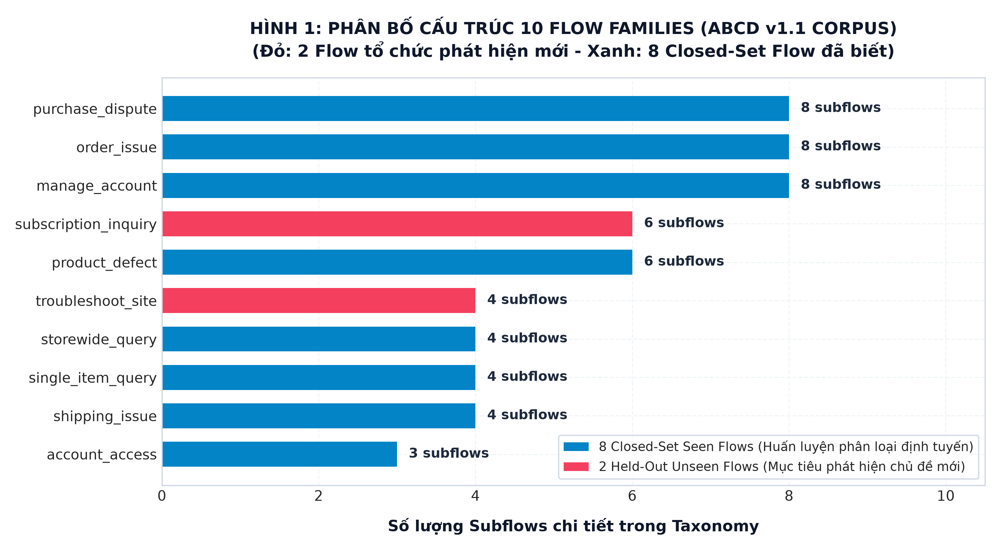
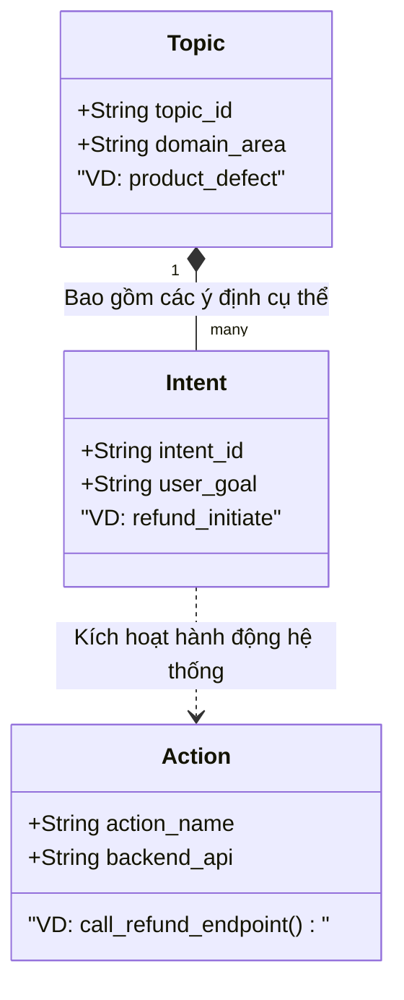

# CHƯƠNG I: TỔNG QUAN VÀ BỐI CẢNH ĐỀ TÀI

---

## 1.1. Bối Cảnh Nghiệp Vụ Chăm Sóc Khách Hàng (Customer Service)

Trong kỷ nguyên chuyển đổi số, các doanh nghiệp thương mại điện tử, dịch vụ tài chính và công nghệ vận hành hệ thống chăm sóc khách hàng (CSKH) trên nhiều kênh tương tác đa dạng:
- **Kênh văn bản (Text/Chat)**: Website live-chat, Facebook Messenger, Zalo OA, Email hỗ trợ, ứng dụng di động.
- **Kênh thoại (Voice/Call Center)**: Tổng đài tiếp nhận cuộc gọi hỗ trợ khách hàng, được chuyển hóa thành văn bản thông qua hệ thống nhận dạng giọng nói (Automatic Speech Recognition - ASR).

Mỗi ngày, hàng chục ngàn đến hàng triệu cuộc hội thoại phát sinh. Doanh nghiệp thường đã thiết lập sẵn một **Danh mục chủ đề cố định (Fixed Taxonomy)** bao gồm các luồng xử lý quen thuộc: tra cứu tài khoản, thay đổi thông tin cá nhân, kiểm tra trạng thái đơn hàng, khiếu nại sản phẩm lỗi, tranh chấp giá cả, v.v.

Tuy nhiên, thị trường và sản phẩm luôn thay đổi nhanh chóng:
1. **Lỗi hệ thống mới phát sinh**: Sự cố cổng thanh toán mới, lỗi sập giỏ hàng sau đợt cập nhật phần mềm.
2. **Chiến dịch kinh doanh mới**: Các gói đăng ký thành viên định kỳ (Subscription), chính sách khuyến mãi đặc thù.
3. **Phản ánh chưa từng có trong quy trình**: Khiếu nại mà nhân viên tổng đài chưa được đào tạo kịch bản xử lý.

Nếu chỉ sử dụng các mô hình phân loại truyền thống (Closed-Set Classifier), mọi câu thoại đều bị **ép buộc gán vào một trong các nhãn có sẵn**. Hậu quả là:
- Các nhu cầu mới bị phân loại sai lệch, làm méo mó số liệu thống kê.
- Doanh nghiệp phản ứng chậm trước các lỗi sản phẩm diện rộng hoặc các xu hướng tiêu dùng mới.
- Khách hàng không nhận được phản hồi thỏa đáng do nhân viên tư vấn đi sai kịch bản nghiệp vụ.

---

## 1.2. Vấn Đề Khoa Học Cần Giải Quyết

Bài toán đặt ra cho Trí tuệ Nhân tạo và Xử lý Ngôn ngữ Tự nhiên (NLP) ở đây không đơn thuần là "học phân loại văn bản", mà là sự kết hợp của nhiều bài toán phức tạp:

| Bài toán thành phần | Câu hỏi cốt lõi | Tiếp cận kỹ thuật |
|---|---|---|
| **Topic Classification (Tập đóng)** | Câu thoại này thuộc chủ đề có sẵn nào trong 10 luồng đã biết? | Embedding Similarity, Logistic Regression, Zero-Shot Classifier |
| **Unknown Detection (Tập mở)** | Câu thoại này có chứa nhu cầu chưa từng xuất hiện trong danh mục hay không? | Threshold Rejection, Cosine Margin, Out-of-Distribution Detection |
| **Novel Topic Discovery (Khám phá)** | Các nội dung chưa khớp lặp lại những nhóm nhu cầu mới nào? | BERTopic, UMAP giảm chiều, HDBSCAN phân cụm mật độ, c-TF-IDF |
| **Evidence Extraction (Trích xuất bằng chứng)** | Cụm từ cụ thể nào trong câu thoại thể hiện nhu cầu của khách hàng? | Token Spans, Sliding Window, Character Offsets |
| **Semantic Verification (Thẩm định ngữ nghĩa)** | Chủ đề mới AI phát hiện có thực sự mạch lạc và mang tính mới hay chỉ là từ rác? | Blinded Review (2 thẩm định viên độc lập), 2-Axis Rubric |

*Hình 1: Cấu trúc 10 nhóm chủ đề (Flow Families) và số lượng Subflows chi tiết trong tập dữ liệu ABCD v1.1 (Màu đỏ biểu thị 2 nhóm chủ đề được giấu đi để kiểm tra năng lực phát hiện tự động).*

---

## 1.3. Phân Biệt Các Khái Niệm Quan Trọng: Topic vs. Intent vs. Action

Một trong những sai lầm phổ biến nhất khi triển khai AI cho hội thoại chăm sóc khách hàng là đánh đồng giữa **Chủ đề (Topic)**, **Ý định (Intent)** và **Hành động (Action)**. Dự án xác lập ranh giới định nghĩa rõ ràng:

### 1. Chủ Đề (Topic / Flow)
- **Định nghĩa**: Lĩnh vực nghiệp vụ, đối tượng hoặc bối cảnh mà cuộc hội thoại nhắc tới.
- **Ví dụ**: `order_issue` (Vấn đề đơn hàng), `product_defect` (Sản phẩm lỗi), `subscription_inquiry` (Hỏi đáp gói đăng ký).
- **Đặc trưng**: Mang tính bao quát, bền vững theo thời gian.

### 2. Ý Định (Intent / Subflow)
- **Định nghĩa**: Mong muốn cụ thể hoặc hành vi tiếp theo mà khách hàng muốn đạt được trong chủ đề đó.
- **Ví dụ**: Cùng thuộc chủ đề `product_defect`, khách hàng có thể có ý định `refund_initiate` (Yêu cầu trả tiền lại) hoặc `return_size` (Xin đổi cỡ giày khác).
- **Đặc trưng**: Gắn liền với mục tiêu cá nhân của khách hàng tại lượt nói.

### 3. Hành Động Hệ Thống (Agent / API Action)
- **Định nghĩa**: Thao tác kỹ thuật mà nhân viên CSKH hoặc hệ thống backend thực hiện để giải quyết yêu cầu.
- **Ví dụ**: `validate_credit_card`, `lookup_order_id`, `issue_refund_api`.
- **Lưu ý**: Hành vi của Agent **không phải là Topic của khách hàng**. Dự án tuyệt đối loại bỏ các hành động của Agent khỏi việc vector hóa chủ đề nhu cầu.

---

## 1.4. Mục Tiêu Nghiên Cứu Của Đề Tài PoC

Dự án được triển khai dưới dạng **Nghiên Cứu & Thử Nghiệm Khả Thi (Proof of Concept - PoC)** nhằm đạt được 4 mục tiêu trọng tâm:

1. **Phân loại có giám sát (Closed-Set Classification)**:
   - Xây dựng mô hình nhúng và phân loại đạt chuẩn trên 10 luồng chủ đề cố định ($Macro\text{-}F1 \ge 0.55$).
2. **Định tuyến nhu cầu chưa biết (Unknown Detection & Routing)**:
   - Nhận diện các câu thoại chứa nhu cầu mới với tỷ lệ chuyển giao vào nhóm khám phá (Routing Recall) đạt $\ge 70\%$ (kết quả thực tế đạt $100\%$).
3. **Tự động gom cụm và mô tả chủ đề mới bằng BERTopic**:
   - Ứng dụng kiến trúc kết hợp Transformer (`all-MiniLM-L6-v2`), giảm chiều UMAP và phân cụm HDBSCAN để tìm ra các nhóm nhu cầu mới, gán nhãn tự động bằng thuật toán c-TF-IDF.
   - Thu hồi thành công 2 họ chủ đề bị ẩn giấu trong thử nghiệm: `subscription_inquiry` và `troubleshoot_site`.
4. **Kiểm soát kiến trúc 4 Gate (G0 $\to$ G3)**:
   - Thiết lập quy trình kiểm thử nghiêm ngặt, cách ly nhãn, ngăn chặn rò rỉ dữ liệu kiểm thử (Data Leakage) và cố định toàn bộ kết quả vào các artifacts chuẩn Schema 1.0.0.

---

## 1.5. Những Câu Hỏi Doanh Nghiệp Cần Trả Lời

Hệ thống được thiết kế để cung cấp câu trả lời định lượng chính xác cho các cấp quản lý:

1. **Khách hàng đang gặp phải những nhóm vấn đề gì nhiều nhất?** $\to$ Báo cáo phân bổ tỷ lệ đàm thoại theo 4 đơn vị đếm chuẩn Schema 1.0.0.
2. **Có những vấn đề phát sinh nào chưa nằm trong danh mục CSKH hiện tại?** $\to$ Tự động cảnh báo và hiển thị các cụm ứng viên mới phát hiện.
3. **Mỗi chủ đề mới ảnh hưởng đến bao nhiêu cuộc hội thoại?** $\to$ Đo lường chỉ số độ hỗ trợ (`conversation_support`).
4. **Có đủ bằng chứng xác thực để bổ sung chủ đề mới vào danh mục chính thức không?** $\to$ Cung cấp biên bản thẩm định mù (Blinded Review) 10 mẫu/cụm kèm tọa độ văn bản bằng chứng nguyên bản.

---

*Chương tiếp theo: [Chương II: Cơ Sở Lý Thuyết & Công Nghệ Lựa Chọn](file:///c:/Hoc_tap/HK1_Nam4_ThucTap/BERTopic/bao_cao/CHUONG_II_CO_SO_LY_THUYET_VA_CONG_NGHE.md)*
