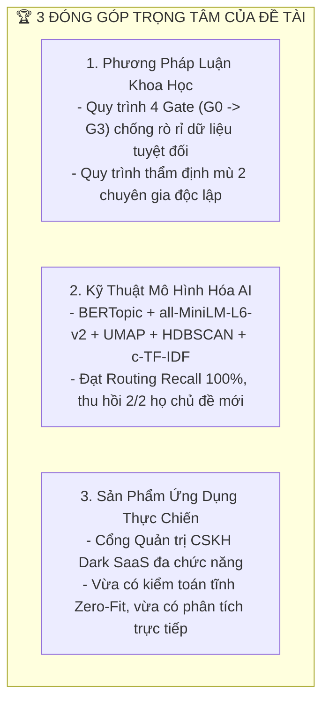
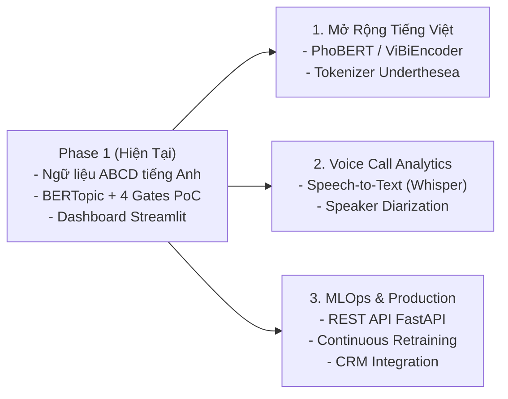

# CHƯƠNG VII: KẾT LUẬN, GIỚI HẠN HỆ THỐNG VÀ HƯỚNG PHÁT TRIỂN TƯƠNG LAI

---

## 7.1. Tổng Kết Các Đóng Góp Chính Của Đề Tài

Sau quá trình nghiên cứu lý thuyết, thiết kế kiến trúc và triển khai thực nghiệm toàn diện, đề tài **"Nghiên cứu ứng dụng mô hình BERTopic trong phân loại chủ đề cố định và tự động khám phá nhu cầu mới từ hội thoại khách hàng"** đã đạt được những kết quả then chốt sau:

### 1. Về Mặt Phương Pháp Luận Khoa Học
- Thiết lập thành công **Kiến trúc Kiểm soát 4 Gate (G0 $\to$ G3)** có mã băm SHA-256 đối soát bất biến, giải quyết triệt để nguy cơ rò rỉ dữ liệu kiểm thử (Test Data Leakage) — một lỗi phổ biến trong các nghiên cứu Học máy hiện nay.
- Xây dựng quy trình **Thẩm định mù ngữ nghĩa (Blinded Semantic Review)** với chiến lược lấy mẫu khách quan 5 đại diện + 5 ngẫu nhiên và rubric đánh giá 2 trục (Mạch lạc & Tính mới), đảm bảo các chủ đề mới AI phát hiện có giá trị thực tiễn cao, không bị ảnh hưởng bởi thiên kiến chủ quan.

### 2. Về Mặt Kỹ Thuật Mô Hình Hóa NLP
- Tối ưu hóa chuỗi xử lý BERTopic trên ngữ liệu hội thoại dịch vụ khách hàng: Lựa chọn mô hình nhúng `all-MiniLM-L6-v2` nhẹ và hiệu quả, kết hợp giảm chiều UMAP và phân cụm mật độ HDBSCAN.
- Đạt kết quả thực nghiệm ấn tượng:
  - **Routing Recall đạt 100.00%** trên tập nhu cầu phát sinh mới ($H_{final}$).
  - Thu hồi thành công **2 / 2 họ chủ đề ẩn** (`subscription_inquiry` với Purity 84.3%, Recall 79.8% và `troubleshoot_site` với Purity 73.8%, Recall 93.2%).
  - Nghiệm thu **498 cụm chủ đề mới** mạch lạc và có ý nghĩa nghiệp vụ.

### 3. Về Mặt Sản Phẩm Ứng Dụng Vận Hành
- Xây dựng hoàn chỉnh **Cổng Thông Tin Quản Trị CSKH Đa Năng** trên nền Streamlit Dark Mode hiện đại.
- Cung cấp song song cả 2 năng lực:
  - *Tầng kiểm toán tĩnh Zero-Fit*: Đọc kết quả đã khóa phục vụ báo cáo khoa học và bảo vệ đề tài.
  - *Tầng tác vụ thực chiến*: Cho phép nhập câu thoại phân tích trực tiếp (<100ms), quét file CSV hàng loạt, và hỗ trợ quản lý bấm nút phê duyệt chủ đề mới đưa vào danh mục Dynamic Taxonomy v1.1 của doanh nghiệp.

---

## 7.2. Tính Minh Bạch Về Các Giới Hạn Kỹ Thuật (System Limitations)

Để đề tài mang tính trung thực khoa học cao nhất, các giới hạn hiện tại của hệ thống được ghi nhận minh bạch:

1. **Giới hạn về ngôn ngữ**:
   - Toàn bộ quy trình thử nghiệm và thẩm định hiện tại chỉ mới được thực hiện trên ngữ liệu **tiếng Anh** từ bộ dữ liệu chuẩn ABCD v1.1. Hệ thống chưa được kiểm chứng chính thức trên tiếng Việt hoặc các ngôn ngữ khác.
2. **Giả định nhãn Proxy cấp kịch bản**:
   - Trong tập ABCD, nhãn `scenario.flow` được gán ở cấp toàn bộ cuộc trò chuyện. Hệ thống coi đây là nhãn đại diện (proxy) cho cuộc gọi, không tự ý gán nhãn scenario làm ground-truth tuyệt đối cho từng phân đoạn câu riêng lẻ.
3. **Sự thiếu hụt metadata thực tế**:
   - Bộ ngữ liệu chuẩn ABCD không ghi nhận mã định danh khách hàng thật (`unique_customers`), mốc thời gian thực tế (`time_bucket`), hay kênh tương tác (`channel`). Hệ thống tuân thủ nghiêm ngặt chuẩn Schema 1.0.0, hiển thị nhãn `\N` theo RFC4180 và **tuyệt đối không tự suy diễn số liệu ảo**.
4. **Bài toán một câu thoại chứa nhiều nhu cầu (Multi-intent)**:
   - Hiện tại, mỗi phân đoạn câu thoại chỉ được gán vào một chủ đề chính (Primary Topic). Trong thực tế, khách hàng có thể phát ngôn những câu thoại phức hợp dài chứa đồng thời 2-3 nhu cầu khác nhau.

---

## 7.3. Lộ Trình Phát Triển Giai Đoạn Tiếp Theo (Phase 2 Roadmap)

Nhằm hoàn thiện giải pháp hướng tới môi trường sản xuất quy mô lớn tại các doanh nghiệp Việt Nam, lộ trình phát triển giai đoạn Phase 2 được định hình theo 3 hướng đột phá:

### Hướng 1: Bản Địa Hóa & Xử Lý Tiếng Việt Chuyên Sâu (Vietnamese NLP)
- Thay thế mô hình nhúng tiếng Anh bằng các mô hình biểu diễn ngữ nghĩa tiếng Việt tiên tiến: `bkai-foundation-models/vietnamese-bi-encoder` hoặc `vinai/phobert-base-v2`.
- Tích hợp công cụ tách từ tiếng Việt chuyên biệt (`pyvi` hoặc `underthesea`) vào bộ phân tích c-TF-IDF để trích xuất từ ghép tiếng Việt chuẩn xác (ví dụ: *"hoàn tiền"*, *"đổi trả"*, *"bảo hành"*).

### Hướng 2: Xử Lý Trực Tiếp Cuộc Gọi Thoại Tổng Đài (Voice Call Analytics)
- Tích hợp pipeline nhận dạng giọng nói tự động **ASR** sử dụng mô hình **OpenAI Whisper** (phiên bản `large-v3`) hoặc **Google Cloud Speech-to-Text**.
- Kết hợp kỹ thuật phân tách người nói (**Speaker Diarization** qua `pyannote.audio`) để tự động tách riêng luồng thoại của Khách hàng và Nhân viên tư vấn từ file ghi âm cuộc gọi stereo/mono, sau đó tự động chuyển giao vào pipeline BERTopic.

### Hướng 3: Kiến Trúc MLOps & Tích Hợp Hệ Thống Doanh Nghiệp (Enterprise Integration)
- Đóng gói động cơ phân loại và khám phá chủ đề thành các dịch vụ vi mô (**Microservices**) thông qua giao diện lập trình ứng dụng **FastAPI** và container Docker.
- Xây dựng cơ chế **Tái huấn luyện liên tục (Continuous Retraining)**: Khi số lượng cụm chủ đề mới được cấp quản lý phê duyệt tích lũy đủ lớn, hệ thống sẽ tự động kích hoạt luồng cập nhật vector chủ đề và tái chuẩn hóa các ngưỡng phân loại.
- Kết nối trực tiếp qua Webhook với các phần mềm quản trị quan hệ khách hàng (CRM) phổ biến như Zendesk, Salesforce, HubSpot, Freshdesk.

---

## 7.4. Lời Kết

Đề tài nghiên cứu đã chứng minh tính khả thi mạnh mẽ của việc ứng dụng mô hình BERTopic trong việc giải quyết bài toán "kép" của ngành chăm sóc khách hàng: vừa duy trì tính ổn định của danh mục phân loại có giám sát, vừa linh hoạt tự động phát hiện các nhu cầu mới phát sinh từ thị trường.

Sự kết hợp giữa **tính nghiêm cẩn của phương pháp luận 4 Gate** và **tính thực tiễn của giao diện quản trị điều hành** tạo nên một nền tảng vững chắc, sẵn sàng để hoàn thiện thành sản phẩm ứng dụng chính thức trong môi trường doanh nghiệp.

---

*Kết thúc toàn văn Báo cáo Tổng kết Đề tài. Trở về [Mục Lục Tổng Quan](file:///c:/Hoc_tap/HK1_Nam4_ThucTap/BERTopic/bao_cao/00_MUC_LUC.md).*
