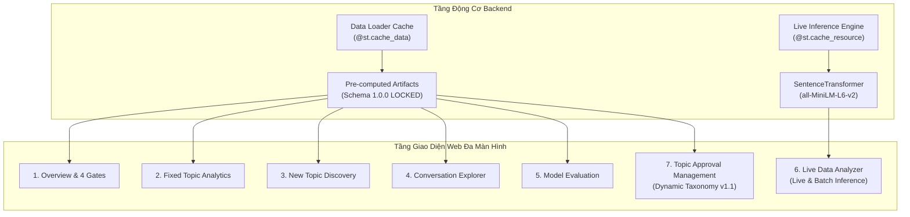

# CHƯƠNG VI: XÂY DỰNG ỨNG DỤNG WEB DASHBOARD PHỤC VỤ QUẢN TRỊ VÀ VẬN HÀNH

---

## 6.1. Mục Tiêu & Định Hướng Kiến Trúc Ứng Dụng

Sau khi các mô hình AI hoàn thành việc đánh giá và nghiệm thu khoa học, yêu cầu đặt ra là làm thế nào để **chuyển giao kết quả nghiên cứu thành một sản phẩm công nghệ có khả năng tương tác trực quan**, phục vụ 2 nhóm đối tượng trọng yếu:
1. **Hội đồng Giám khảo / Giảng viên**: Cần một công cụ để kiểm chứng quy trình 4 Gate, đối soát mã băm tính toàn vẹn của artifacts, kiểm tra các chỉ số đo lường học thuật và xem toàn văn báo cáo.
2. **Cấp Quản lý Doanh nghiệp (Sếp / Trưởng bộ phận CSKH)**: Cần một giao diện quản trị điều hành (Executive Portal) có thể tự tay thử nghiệm: nhập câu thoại bất kỳ để xem AI phân loại ra sao, tải file dữ liệu hội thoại mới lên để chạy phân tích hàng loạt, và trực tiếp phê duyệt các chủ đề mới do AI đề xuất đưa vào danh mục vận hành.

Hệ thống được xây dựng trên nền tảng **Streamlit kết hợp Plotly**, áp dụng phong cách thiết kế **Dark Mode AI SaaS (Giao diện Tối - Chống chói)** hiện đại.

---

## 6.2. Chi Tiết Các Phân Hệ Màn Hình Chức Năng

### 1. Phân Hệ Trang Chủ: Bảng Điều Khiển Quản Lý (`app.py`)
- **Hero Header**: Thiết kế dạng dải gradient đêm sâu (`#020617` đến `#0f172a`), hiển thị các huy hiệu trạng thái: *4 Gates Verified*, *Zero-Fit Mode*, *PII Masked*, *Acceptance: VALID*.
- **Thẻ KPI Tổng Quan**: 4 thẻ số liệu kích thước lớn có hiệu ứng hover nổi: Tổng 10.042 cuộc hội thoại ABCD v1.1, 103.901 phân đoạn xử lý, 100% Routing Recall, và 2/2 Flow Recovery.
- **Thanh Tác Vụ Quản Lý 1 Chạm**: 2 nút lớn dẫn thẳng đến các tính năng thực chiến: *Chạy Phân Tích Trực Tiếp* và *Phê Duyệt Chủ Đề Mới*.
- **Tab Thử Nghiệm Nhanh Thời Gian Thực**: Tích hợp 4 nút tình huống mẫu thực tế (Lỗi sản phẩm, Hủy đơn hàng, Khiếu nại cước phí, Lỗi website). Người dùng bấm chọn hoặc tự gõ câu thoại $\to$ Bấm *"🚀 Chạy Phân Tích Ngay"* $\to$ Kết quả hiển thị tức thì trong **<100ms** kèm tô sáng cụm từ bằng chứng.
- **Biểu Đồ Phân Bổ Chủ Đề Tương Tác**: Cho phép chuyển đổi linh hoạt giữa Biểu đồ Cột Ngang, Biểu đồ Tròn (Donut), và Biểu đồ Cột Đứng với bảng màu Neon sinh động, hover xem chi tiết số cuộc hội thoại và tỷ lệ phần trăm.

### 2. Phân Hệ 1: Overview & Giám Sát Tiến Trình Gates (`1_Overview.py`)
- **Mục đích**: Phục vụ kiểm toán tính toàn vẹn khoa học.
- **Tính năng chính**:
  - Trực quan hóa quy trình 4 Gate kiến trúc (G0 $\to$ G1 $\to$ G2 $\to$ G3) dạng thẻ tiến trình với huy hiệu **LOCKED** màu xanh lá.
  - Vết thời gian khóa UTC và bảng đối soát mã băm SHA-256 từng tệp kết quả.
  - Hiển thị thông số cấu hình mô hình thắng cuộc `all-MiniLM-L6-v2`, ngưỡng phân loại ($\tau = 0.20, \delta = 0.05$) và siêu tham số UMAP/HDBSCAN.
  - Bảng sức khỏe dữ liệu (Data Quality) và phân bổ phân đoạn câu thoại.

### 3. Phân Hệ 2: Phân Tích Chủ Đề Cố Định (`2_Fixed_Topic_Analytics.py`)
- **Mục đích**: Báo cáo phân bổ 10 luồng chủ đề phân loại có giám sát.
- **Tính năng chính**:
  - Bộ chọn phạm vi (Scope Selector): Chuyển đổi giữa `scope:test_open` (7 Known flows, mẫu số $N=898$) và `scope:test_closed` (10 Closed flows, mẫu số $N=1.004$).
  - Biểu đồ phân bổ tỷ lệ hội thoại (`conversation_share`) dạng Plotly Dark.
  - Bảng chi tiết 4 đơn vị đếm thống kê theo chuẩn Schema 1.0.0:
    1. `customer_message_count`: Số câu thoại khách hàng phát ngôn.
    2. `source_messages_with_assignment`: Số lượt thoại được gán chủ đề.
    3. `segment_count`: Số phân đoạn văn bản trích xuất.
    4. `conversation_count`: Số cuộc hội thoại có đề cập đến chủ đề.
  - Khối cảnh báo minh bạch: Các trường metadata không có trong bộ ngữ liệu ABCD (`unique_customers`, `time_bucket`, `channel`) hiển thị trung thực nhãn `\N` theo chuẩn RFC4180, cam kết không tự chế số liệu giả.

### 4. Phân Hệ 3: Khám Phá & Thẩm Định Chủ Đề Mới (`3_New_Topic_Discovery.py`)
- **Mục đích**: Khám phá 1.552 cụm ứng viên và theo dõi kết quả thẩm định mù.
- **Tính năng chính**:
  - Bộ lọc đa chiều theo Random Seed (Seed 42, 13, 73), trạng thái thẩm định (`accepted_novel`, `monitor`, `proposed`) và ô tìm kiếm từ khóa c-TF-IDF.
  - Khung xem chi tiết cụm: Top 10 từ khóa đặc trưng, độ hỗ trợ hội thoại (`conversation_support`), và chủ đề gần nhất trong kho.
  - Biên bản thẩm định mù (Blinded Review): Hiển thị chi tiết **10 mẫu kiểm tra** (5 mẫu gần tâm centroid + 5 mẫu ngẫu nhiên độc lập) cùng điểm số rubric 2 trục (Mạch lạc & Tính mới) của 2 chuyên gia độc lập.
  - Đồ thị sáp nhập cụm (Merge DAG): Trực quan hóa quan hệ kế thừa giữa các cụm tương đồng, xác nhận cấu trúc phi chu trình (0 Cycles, 0 Invalid Targets).

### 5. Phân Hệ 4: Khám Phá Hội Thoại & Highlight Bằng Chứng (`4_Conversation_Explorer.py`)
- **Mục đích**: Cho phép chuyên viên tra cứu chi tiết từng cuộc trò chuyện và kiểm tra vùng bằng chứng ngữ nghĩa.
- **Tính năng chính**:
  - Tìm kiếm theo `conversation_id`, lọc theo chủ đề và trạng thái bằng chứng (`human_verified`, `model_supported`, `cluster_only`).
  - Phân trang mượt mà (10, 25, 50 dòng/trang) giúp tải dữ liệu nhanh chóng mà không gây tràn bộ nhớ DOM trình duyệt.
  - Khung hiển thị câu thoại khách hàng đã che mờ PII (`masked_customer_text`). Vùng văn bản bằng chứng được tô màu nổi bật (highlight) theo đúng tọa độ ký tự `[span_start:span_end]`.
  - Khung xem chi tiết ngữ cảnh: Hiển thị lời thoại của Agent trước đó (`context_text`) và điểm số tương đồng cosine.

### 6. Phân Hệ 5: Đánh Giá Mô Hình & Báo Cáo Nghiệm Thu (`5_Model_Evaluation.py`)
- **Mục đích**: Cung cấp bức tranh toàn cảnh về hiệu năng đo lường khoa học.
- **Tính năng chính**:
  - Các thẻ KPI đo lường cốt lõi (Macro-F1 0.5553, Unknown F1 0.3618, Routing Recall 100%) kèm khoảng tin cậy Bootstrap 95%.
  - Ma trận thu hồi Flow-Family Recovery chi tiết cho 2 họ chủ đề `subscription_inquiry` và `troubleshoot_site` kèm trạng thái xác thực ngữ nghĩa (`HUMAN_VERIFIED`).
  - Biểu đồ so sánh độ ổn định phân cụm ARI giữa 3 Random Seeds và biểu đồ độ chính xác theo nhóm độ dài lượt thoại khách hàng.
  - Trình đọc toàn văn báo cáo Markdown `report.md` tích hợp nút tải xuống tệp văn bản gốc.

### 7. Phân Hệ 6: Chạy Dữ Liệu & Phân Tích Trực Tiếp (`6_Live_Data_Analyzer.py`)
- **Mục đích**: Công cụ tác vụ thực chiến dành cho chuyên viên và quản lý CSKH khi demo sản phẩm.
- **Tính năng chính**:
  - **Tab 1 - Live Text Analyzer**:
    - Nhập câu thoại tùy ý hoặc chọn nhanh 5 nút tình huống thực tế.
    - Bấm *"🚀 Chạy Phân Tích Ngay"* $\to$ Hệ thống phản hồi trong <100ms: Tên chủ đề, độ tin cậy %, phân loại Known hay Novel, tô sáng bằng chứng và biểu đồ thanh ngang so khớp xác suất Top 4 chủ đề.
  - **Tab 2 - Batch CSV Processing (Quét tệp hàng loạt)**:
    - Cho phép tải tệp CSV lên hoặc bấm nút *"⚡ Nạp 15 câu thoại mẫu ABCD"*.
    - Bấm nút *"▶️ Chạy Phân Tích Hàng Loạt"* $\to$ Thanh tiến trình chạy trực quan $\to$ Trả về thẻ KPI tổng kết, biểu đồ phân bổ chủ đề trong tệp, bảng kết quả chi tiết và nút *"📥 Tải Xuống File Báo Cáo Kết Quả (CSV)"*.

### 8. Phân Hệ 7: Quản Trị & Phê Duyệt Danh Mục Chủ Đề (`7_Topic_Approval_Management.py`)
- **Mục đích**: Cổng phê duyệt tác vụ dành riêng cho cấp quản lý vận hành.
- **Tính năng chính**:
  - Danh sách các cụm chủ đề mới do AI đề xuất kèm Top 10 từ khóa và số hội thoại hỗ trợ.
  - Quản lý có thể thực hiện 3 hành động nghiệp vụ trực tiếp:
    1. **[✅ Phê Duyệt Thêm Vào Danh Mục]**: Đặt tên flow mới $\to$ Tự động mở rộng danh mục Dynamic Taxonomy v1.1 của công ty theo thời gian thực.
    2. **[🔗 Sáp Nhập Vào Flow Có Sẵn]**: Gộp các cụm tương đồng vào luồng đã có.
    3. **[👁️ Đưa Vào Danh Sách Theo Dõi (Monitor)]**.
  - Bảng danh mục Taxonomy mở rộng hiển thị realtime kèm nút *"📥 Tải Xuống Danh Mục Taxonomy Mới (JSON)"*.

---

## 6.3. Hai Phiên Bản Khởi Chạy Song Song

Dự án cung cấp 2 kịch bản khởi chạy độc lập phục vụ linh hoạt cho từng đối tượng báo cáo:

| Phiên bản | Tệp khởi chạy | Cổng dịch vụ | Mục đích sử dụng tối ưu |
|---|---|---|---|
| **Bản 1 (Bản cũ gốc)** | `app_v1_report.py` | `http://localhost:8502` | **Bảo vệ Khóa luận / Hội đồng Khoa học**: Giao diện thuần báo cáo, tập trung vào 4 Gate, mã băm đối soát và bảng F1/Recall theo nguyên tắc Zero-Fit. |
| **Bản 2 (Bản mới)** | `app.py` | `http://localhost:8501` | **Demo Thực Chiến cho Doanh nghiệp / Sếp**: Giao diện Dark SaaS, tích hợp công cụ gõ text phân tích tức thì, quét file CSV và phê duyệt chủ đề mới. |

Cả hai phiên bản đều có thể chạy đồng thời trong môi trường ảo `.venv` mà không gây xung đột tài nguyên.

---

*Chương tiếp theo: [Chương VII: Kết Luận, Giới Hạn Hệ Thống & Hướng Phát Triển Tương Lai](file:///c:/Hoc_tap/HK1_Nam4_ThucTap/BERTopic/bao_cao/CHUONG_VII_KET_LUAN_GIOI_HAN_VA_HUONG_PHAT_TRIEN.md)*
